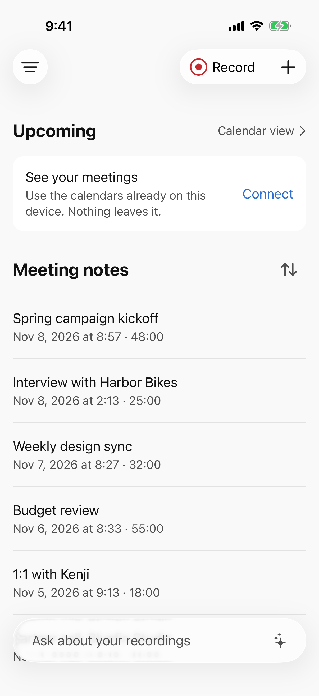
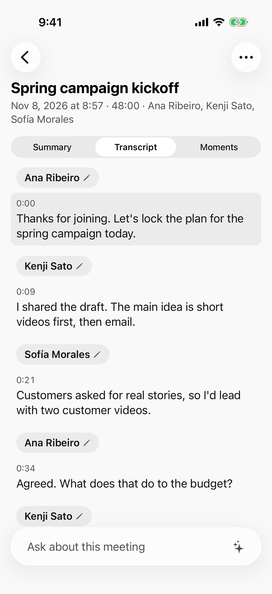
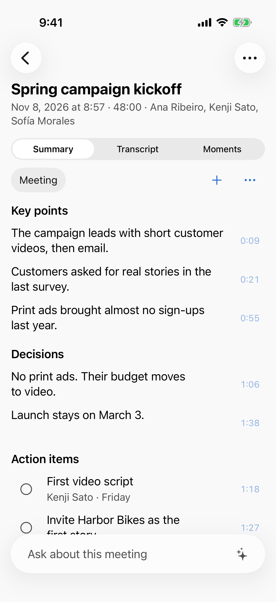
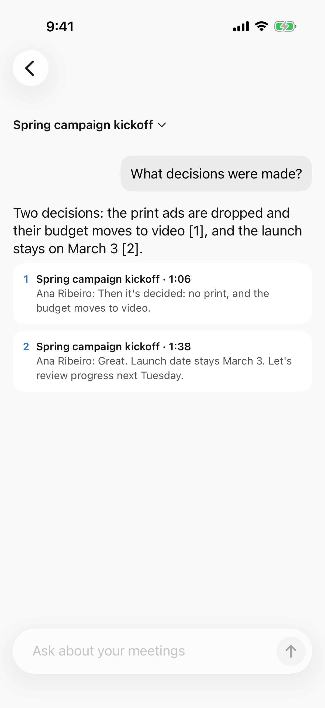
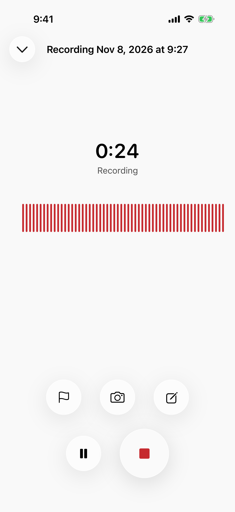
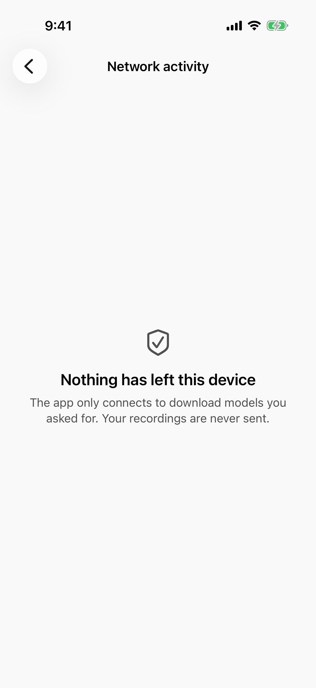

<p align="center"></p>

<h1 align="center">Meetlaud</h1>

<p align="center"><strong>Tus reuniones, recordadas. En tu iPhone, no en la nube de otro.</strong></p>

<p align="center">
<a href="README.md">English</a> · <a href="README.ja.md">日本語</a> · <a href="README.pt-BR.md">Português</a> · Español
</p>

<p align="center">


</p>

Meetlaud graba tus reuniones, las transcribe, te dice quién dijo qué, escribe el resumen y responde a tus preguntas sobre ellas. Todo funciona en tu iPhone o iPad.

- **Nada que comprar.** Ni grabadora ni aparato en la solapa. El teléfono que llevas en el bolsillo ya tiene un gran micrófono y un chip pensado para IA.
- **Nada que pagar cada mes.** Sin suscripción y sin límite de minutos. Graba un taller de 3 horas tantas veces como quieras.
- **Ningún sitio adonde puedan ir tus datos.** Sin cuenta y sin servidor. Tus grabaciones nunca salen del dispositivo, salvo que tú mismo las envíes.
- **Nada que creer a ciegas.** El código es abierto. Cualquiera puede leerlo y comprobar cada promesa de esta página.

<p align="center">
<picture><source media="(prefers-color-scheme: dark)" srcset="docs/screenshots/01-home-dark.png"></picture>
<picture><source media="(prefers-color-scheme: dark)" srcset="docs/screenshots/02-transcript-dark.png"></picture>
<picture><source media="(prefers-color-scheme: dark)" srcset="docs/screenshots/03-summary-dark.png"></picture>
<picture><source media="(prefers-color-scheme: dark)" srcset="docs/screenshots/04-ask-dark.png"></picture>
</p>

<p align="center"><sub>Las imágenes usan reuniones y personas ficticias. Aparecen en inglés, y la app también está en español.</sub></p>

> **Estado: prelanzamiento.** Todas las funciones de abajo están hechas y probadas, y los flujos principales (grabar, transcribir, identificar a cada persona, resumir) ya funcionaron en un iPhone 17 real. Aún no está en el App Store. Puedes compilarla hoy (mira "Compílalo tú mismo"), y pronto habrá un TestFlight público.

## Por qué Meetlaud

La mayoría de los asistentes de reuniones con IA te piden comprar un aparato, pagar un plan mensual y enviar tu audio a servidores que nunca verás. En una llamada de ventas, una reunión de dirección, una consulta médica o una entrevista de trabajo, eso es pedir demasiado.

Los teléfonos ya son lo bastante rápidos para hacer este trabajo por sí solos. Meetlaud usa modelos de IA abiertos que funcionan directamente en el Neural Engine y la GPU del iPhone. Una vez descargado un modelo, todo funciona en modo avión.

| | Meetlaud |
|---|---|
| Hardware | El iPhone o iPad que ya tienes |
| Precio | Gratis y de código abierto |
| Límite de grabación | Ninguno |
| Dónde funciona la IA | En tu dispositivo |
| Cuenta | Ninguna. No hay nada que registrar |
| Sin conexión | Sí, después de descargar los modelos |
| Código fuente | Abierto, Apache-2.0 |

## Qué hace

**Grabar**
- Un toque para grabar: desde la app, un widget, la pantalla bloqueada, el centro de control, el botón de acción o Atajos.
- Sigue grabando con la pantalla bloqueada o la app en segundo plano, con una Actividad en Vivo.
- Resiste fallos e interrupciones: una grabación cortada por una llamada o un cierre inesperado se recupera.
- Marca momentos, toma notas y haz fotos mientras grabas.
- Importa archivos de audio que ya tengas.

**Entender**
- **Transcripción** con Whisper o Apple Speech, probada en inglés, japonés, portugués y español. Toca cualquier frase para escucharla.
- **Quién habla:** la transcripción muestra quién habló y cuándo. Ponle nombre a una voz una vez, y Meetlaud puede sugerir a esa persona en la siguiente reunión. Las huellas de voz son opcionales y se quedan en el dispositivo.
- **Resúmenes** a partir de plantillas (reunión, entrevista, clase, llamada y más) o de una tuya. Cada punto clave, decisión y tarea enlaza con el momento en que se dijo, para que lo compruebes.
- **Pregunta:** consulta una reunión, una carpeta o toda tu biblioteca. Las respuestas citan sus fuentes.
- Las tareas van a Recordatorios. Mapas mentales, vocabulario propio para nombres y jerga, y un modo de lectura limpio, sin "eh" ni "este".

**Mantener el control**
- Carpetas, búsqueda en todas las transcripciones y un calendario con reuniones y grabaciones.
- Bloqueo con Face ID y exportación de toda tu biblioteca protegida con contraseña.
- **Pantalla de modelos de IA:** elige el modelo para cada tarea, mira cuál le va bien a tu dispositivo y haz una prueba de velocidad con tu propio audio.
- **Pantalla de actividad de red:** muestra cada conexión que la app ha hecho. En una instalación nueva dice "Nada ha salido de este dispositivo".
- Interfaz en inglés, japonés, portugués y español, con VoiceOver y tipo de letra dinámico.

<p align="center">
<picture><source media="(prefers-color-scheme: dark)" srcset="docs/screenshots/05-recording-dark.png"></picture>
<picture><source media="(prefers-color-scheme: dark)" srcset="docs/screenshots/06-network-dark.png"></picture>
</p>

## Privacidad que puedes comprobar

Meetlaud hace exactamente dos tipos de conexión, y ambos aparecen en **Ajustes > Actividad de red**:

1. **Descargas de modelos de IA que tú inicias.** Vienen de Hugging Face, en versiones fijas y con hash verificado. No se envía nada de tus reuniones.
2. **Opcional: tu propio ordenador.** Si emparejas una app de escritorio en tu propia red, las nuevas reuniones van directamente a ella, cifradas. Hoy funciona con [Get Things Done](https://github.com/geovanneb/get-things-done), una memoria de trabajo de código abierto para herramientas de IA, que funciona en tu ordenador. Nada pasa por internet.

No hay analítica, ni servicio de informes de fallos, ni publicidad, ni cuenta. La compilación lo garantiza: `make check` falla si cualquier código fuera del módulo de descargas y del conector con tu ordenador abre una conexión de red. Detalles en [Privacidad](docs/PRIVACY.es.md).

## Requisitos

| | Graba y transcribe | Resúmenes y preguntas |
|---|---|---|
| iPhone o iPad con iOS / iPadOS 26 | Sí | Necesita unos 8 GB de memoria (por ejemplo, iPhone 15 Pro o posterior, o un iPad con chip M) |

Los modelos se descargan una sola vez, por Wi-Fi por defecto: unos 0,2 a 0,7 GB para transcribir y 1,6 GB para resumir. Apple Speech no necesita descarga.

## Compílalo tú mismo

Necesitas un Mac con Xcode 26 y [Homebrew](https://brew.sh).

```sh
git clone <este repositorio>
cd meetlaud
make bootstrap        # instala las herramientas y genera el proyecto de Xcode
open Meetlaud.xcodeproj
```

Ejecuta el esquema `Meetlaud` en un simulador. Para usarla en tu iPhone, añade el ID de tu equipo en `Config/Local.xcconfig` (mira [CONTRIBUTING.md](CONTRIBUTING.md), en inglés).

## Cómo funciona

Swift 6 y SwiftUI, en paquetes Swift locales con límites estrictos: la capa de dominio es Swift puro, cada motor de IA está detrás de un puerto, y solo un modelo grande está en memoria a la vez.

| Tarea | Motor | Licencia del modelo |
|---|---|---|
| Transcripción | [WhisperKit](https://github.com/argmaxinc/argmax-oss-swift) (Core ML), Apple Speech | MIT (Whisper) |
| Quién habla y huellas de voz | [FluidAudio](https://github.com/FluidInference/FluidAudio) (pyannote Community-1, Core ML) | CC-BY-4.0 |
| Resúmenes y preguntas | [MLX Swift](https://github.com/ml-explore/mlx-swift) con Qwen 3.5 2B | Apache-2.0 |
| Búsqueda | Embeddings de Apple en el dispositivo, SQLite FTS5 con [GRDB](https://github.com/groue/GRDB.swift) | |

La documentación técnica está en inglés: [Arquitectura](docs/architecture.md) · [IA en el dispositivo](docs/on-device-ai.md) · [Modelos](docs/model-management.md) · [Conectores](docs/connectors.md) · [Toda la documentación](docs/README.md)

## Cómo contribuir

Las contribuciones son bienvenidas, desde una errata hasta un nuevo modelo de lenguaje. Empieza por [CONTRIBUTING.md](CONTRIBUTING.md). Puedes abrir issues en español. Buenos puntos de partida:

- **Traducciones:** revisión nativa de japonés, portugués y español.
- **Pruebas en dispositivos reales:** iPhone antiguos, iPad, reuniones largas, salas ruidosas.
- **Plantillas de resumen** para tu profesión.
- **Android:** está prevista una app nativa para Android. Mira [Bringing Meetlaud to Android](docs/porting-android.md).

Mira el [roadmap](ROADMAP.md) para saber qué viene. ¿Encontraste un problema de privacidad o seguridad? Sigue [SECURITY.md](SECURITY.md) en lugar de abrir una issue pública.

## Conviene saber

- **La IA puede equivocarse.** Los resúmenes y las respuestas enlazan con sus fuentes para que las compruebes. No te fíes de ellos para decisiones médicas, legales o financieras sin comprobarlos.
- **Pide permiso antes de grabar.** Las leyes sobre grabar conversaciones cambian según el país, y algunas exigen el consentimiento de todos. Es tu responsabilidad, y la app te lo recuerda antes de tu primera grabación.
- **Llamadas telefónicas:** iOS no permite que las apps graben llamadas. Puedes importar las grabaciones que haga el propio iOS.

## Licencia y marcas

El código usa la licencia [Apache-2.0](LICENSE). Los modelos y las bibliotecas mantienen sus propias licencias, listadas en [THIRD_PARTY_NOTICES.md](THIRD_PARTY_NOTICES.md).

La licencia Apache cubre el código, no el nombre ni el logo de Meetlaud. Puedes hacer un fork cuando quieras. Solo dale a tu versión otro nombre y otro icono, para que la gente pueda distinguirlas.

Meetlaud es un proyecto independiente. No tiene relación con ningún fabricante de grabadoras ni servicio de notas, ni cuenta con su respaldo o patrocinio. iPhone, iPad y Apple son marcas de Apple Inc. Las demás marcas pertenecen a sus dueños.
