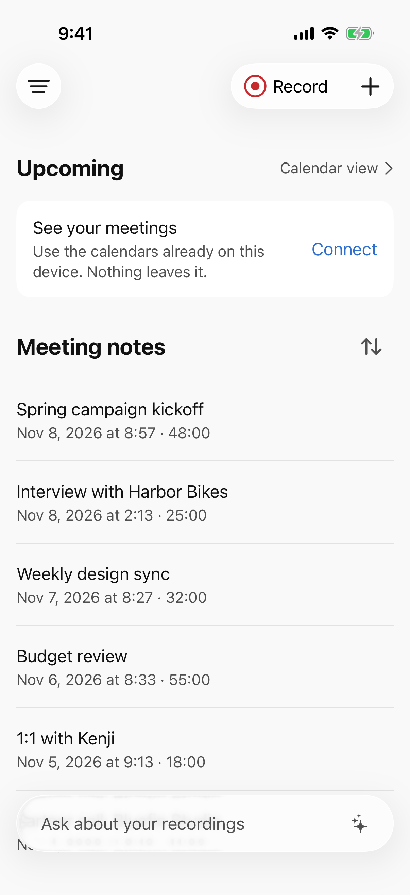
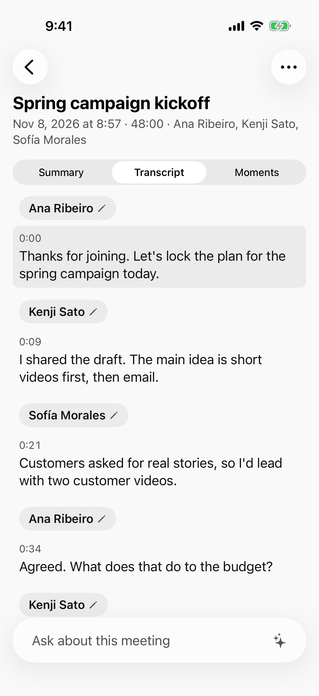
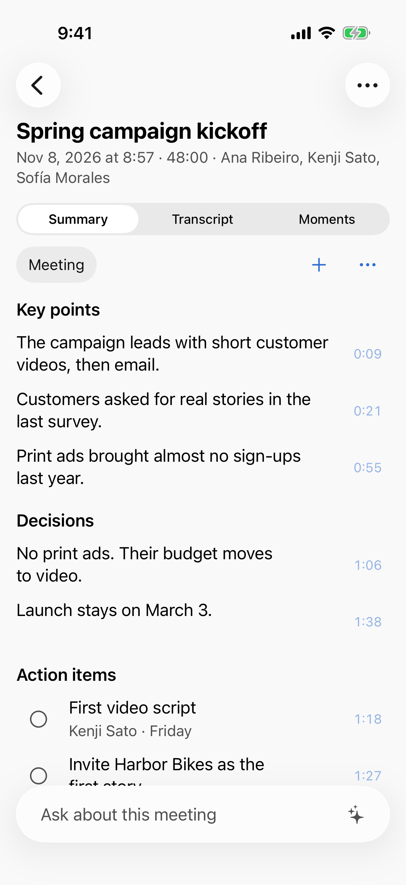
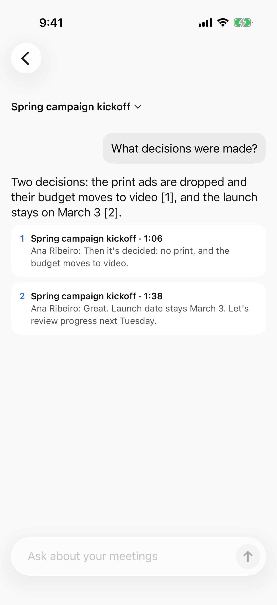
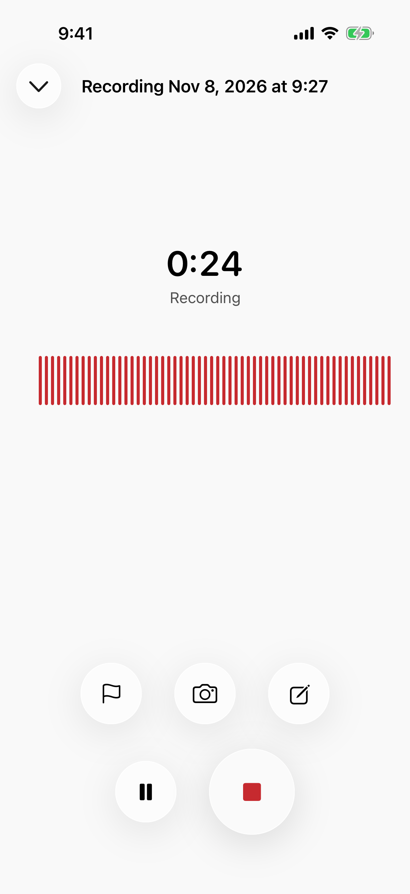
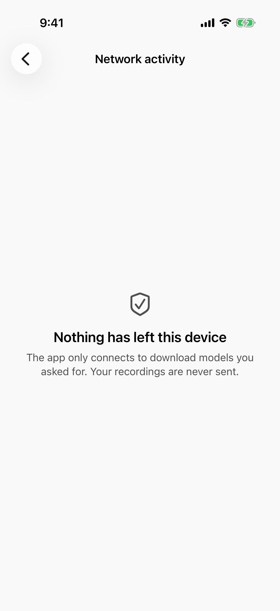

<p align="center"></p>

<h1 align="center">Meetlaud</h1>

<p align="center"><strong>会議の記憶を、あなたの iPhone に。誰かのクラウドではなく。</strong></p>

<p align="center">
<a href="README.md">English</a> · 日本語 · <a href="README.pt-BR.md">Português</a> · <a href="README.es.md">Español</a>
</p>

<p align="center">


</p>

Meetlaud は会議を録音し、文字に起こし、誰が何を話したかを示し、要約を書き、会議についての質問に答えます。すべて iPhone や iPad の中で動きます。

- **買うものはありません。** 専用レコーダーもクリップ型デバイスも不要です。ポケットの iPhone には、優れたマイクと AI のためのチップがすでに入っています。
- **毎月払うものもありません。** サブスクリプションも、分数の上限もありません。3 時間のワークショップも、何度でも録音できます。
- **データの行き先がありません。** アカウントもサーバーもありません。あなた自身が送らない限り、録音が端末の外に出ることはありません。
- **信じるだけではありません。** コードは公開されています。このページの約束はすべて、誰でも読んで確かめられます。

<p align="center">
<picture><source media="(prefers-color-scheme: dark)" srcset="docs/screenshots/01-home-dark.png"></picture>
<picture><source media="(prefers-color-scheme: dark)" srcset="docs/screenshots/02-transcript-dark.png"></picture>
<picture><source media="(prefers-color-scheme: dark)" srcset="docs/screenshots/03-summary-dark.png"></picture>
<picture><source media="(prefers-color-scheme: dark)" srcset="docs/screenshots/04-ask-dark.png"></picture>
</p>

<p align="center"><sub>画像の会議と人物は架空のものです。画像は英語表示ですが、アプリは日本語にも対応しています。</sub></p>

> **ステータス: リリース前。** 以下の機能はすべて実装・テスト済みで、主要な流れ(録音、文字起こし、話者の識別、要約)は実機の iPhone 17 で動作を確認しています。App Store にはまだありません。今すぐ自分でビルドでき(「自分でビルドする」を参照)、次は公開 TestFlight を予定しています。

## なぜ Meetlaud なのか

多くの AI 議事録ツールは、デバイスの購入、月額プラン、そして見えないサーバーへの音声送信を求めます。商談、役員会議、診察、採用面接では、それは大きな負担です。

今のスマートフォンは、この仕事を自分でこなせるほど速くなりました。Meetlaud はオープンな AI モデルを iPhone の Neural Engine と GPU で直接動かします。モデルを一度ダウンロードすれば、機内モードでも使えます。

| | Meetlaud |
|---|---|
| ハードウェア | お手持ちの iPhone または iPad |
| 価格 | 無料・オープンソース |
| 録音の上限 | なし |
| AI が動く場所 | あなたの端末の中 |
| アカウント | 不要。登録するものがありません |
| オフライン | 対応(モデルのダウンロード後) |
| ソースコード | 公開、Apache-2.0 |

## できること

**録音する**
- アプリ、ウィジェット、ロック画面、コントロールセンター、アクションボタン、ショートカットから、ワンタップで録音。
- 画面をロックしても、アプリがバックグラウンドでも、ライブアクティビティとともに録音を続けます。
- 障害や中断に強い設計: 電話やクラッシュで途切れた録音も復元します。
- 録音中に、瞬間のマーク、メモ、写真を残せます。
- 手元の音声ファイルも読み込めます。

**理解する**
- **文字起こし**は Whisper または Apple Speech で。英語・日本語・ポルトガル語・スペイン語で検証済みです。どの行もタップすればその部分を再生します。
- **話者の識別:** 誰がいつ話したかを文字起こしに表示します。一度声に名前をつければ、次の会議でその人を提案できます。声紋は任意で、端末の外には出ません。
- **要約**はテンプレート(会議、面接、講義、通話など)または自作のテンプレートから。要点・決定事項・タスクのそれぞれが発言の瞬間にリンクしているので、すぐに確認できます。
- **質問する:** 1 つの会議、フォルダ、ライブラリ全体に質問できます。答えには出典がつきます。
- タスクはリマインダーへ。マインドマップ、人名や専門用語のための単語登録、「えーと」「あのー」を省いた読みやすい表示もあります。

**自分で管理する**
- フォルダ、全文字起こしの検索、会議と録音のカレンダー表示。
- Face ID によるアプリのロックと、パスワードで保護したライブラリ全体の書き出し。
- **AI モデル画面:** 処理ごとにモデルを選び、端末に合うものを確認し、自分の音声で速度テストができます。
- **ネットワークアクティビティ画面:** モデルのダウンロードや、ペアリングしたコンピュータへの送信など、アプリの通信をすべて表示します。新しくインストールした状態では「このデバイスから何も送信されていません」と表示されます。履歴は消去できます。
- 英語・日本語・ポルトガル語・スペイン語のインターフェース。VoiceOver と「さらに大きな文字」に対応。

<p align="center">
<picture><source media="(prefers-color-scheme: dark)" srcset="docs/screenshots/05-recording-dark.png"></picture>
<picture><source media="(prefers-color-scheme: dark)" srcset="docs/screenshots/06-network-dark.png"></picture>
</p>

## 確かめられるプライバシー

Meetlaud の通信は 2 種類だけで、どちらも **設定 > ネットワークアクティビティ** に表示されます。

1. **あなたが開始する AI モデルのダウンロード。** Hugging Face から、固定したバージョンとハッシュ検証つきで取得します。会議の内容は一切送りません。
2. **任意: あなた自身のコンピュータ。** 自分のネットワーク上のデスクトップアプリとペアリングすると、新しい会議が暗号化されて直接そこへ届きます。現在は [Get Things Done](https://github.com/geovanneb/get-things-done)(コンピュータ上で動く、AI ツールのためのオープンソースのワークメモリ)に対応しています。インターネットは経由しません。

アナリティクス、クラッシュレポートサービス、広告、アカウントはありません。これはビルドで強制しています。ダウンロード用モジュールとコンピュータへのコネクタ以外のコードが通信を開くと、`make check` が失敗します。詳しくは [プライバシー](docs/PRIVACY.ja.md) をご覧ください。

## 動作環境

| | 録音と文字起こし | 要約と質問 |
|---|---|---|
| iOS / iPadOS 26 の iPhone または iPad | 対応 | 約 8 GB のメモリが必要(例: iPhone 15 Pro 以降、M チップ搭載の iPad) |

モデルのダウンロードは一度だけで、標準では Wi-Fi 接続時のみです。文字起こし用に約 0.2〜0.7 GB、要約用に 1.6 GB。Apple Speech はダウンロード不要です。

## 自分でビルドする

Xcode 26 と [Homebrew](https://brew.sh) が入った Mac が必要です。

```sh
git clone <このリポジトリ>
cd meetlaud
make bootstrap        # ツールを入れて Xcode プロジェクトを生成
open Meetlaud.xcodeproj
```

シミュレータで `Meetlaud` スキームを実行します。自分の iPhone で動かすには、`Config/Local.xcconfig` にチーム ID と自分用のバンドル ID を書きます([CONTRIBUTING.md](CONTRIBUTING.md)、英語)。

## 仕組み

Swift 6 と SwiftUI。境界を厳しく分けたローカル Swift パッケージで構成しています。ドメイン層は純粋な Swift、AI エンジンはすべてポートの向こう側、メモリに載る大きなモデルは常に 1 つだけです。

| 処理 | エンジン | モデルのライセンス |
|---|---|---|
| 文字起こし | [WhisperKit](https://github.com/argmaxinc/argmax-oss-swift)(Core ML)、Apple Speech | MIT(Whisper) |
| 話者の識別と声紋 | [FluidAudio](https://github.com/FluidInference/FluidAudio)(pyannote Community-1、Core ML) | CC-BY-4.0 |
| 要約と質問 | [MLX Swift](https://github.com/ml-explore/mlx-swift) と Qwen 3.5 2B | Apache-2.0 |
| 検索 | Apple の端末内埋め込み、[GRDB](https://github.com/groue/GRDB.swift) による SQLite FTS5 | |

技術ドキュメントは英語です: [アーキテクチャ](docs/architecture.md) · [端末内 AI](docs/on-device-ai.md) · [モデル管理](docs/model-management.md) · [コネクタ](docs/connectors.md) · [ドキュメント一覧](docs/README.md)

## コントリビュート

誤字の修正から新しい言語モデルまで、どんな貢献も歓迎します。まず [CONTRIBUTING.md](CONTRIBUTING.md) をご覧ください。Issue は日本語で書いても大丈夫です。始めやすいのは次のような分野です。

- **翻訳:** 日本語・ポルトガル語・スペイン語のネイティブチェック。
- **実機テスト:** 古い iPhone、iPad、長時間の会議、騒がしい部屋。
- **あなたの職種に合った要約テンプレート。**
- **Android:** ネイティブの Android アプリを計画しています。[Bringing Meetlaud to Android](docs/porting-android.md) をご覧ください。

今後の予定は [ロードマップ](ROADMAP.md) にあります。プライバシーやセキュリティの問題を見つけた場合は、公開 Issue ではなく [SECURITY.md](SECURITY.md) の手順に従ってください。

## ご注意

- **AI は間違えることがあります。** 要約と回答には出典へのリンクがあるので、確認できます。医療・法律・金融の判断に使う前には、必ず確認してください。
- **録音の前に同意を。** 会話の録音に関する法律は国や地域によって異なり、全員の同意が必要な場合もあります。これは利用者の責任であり、アプリは最初の録音の前にお知らせします。
- **電話の録音:** iOS はアプリによる通話の録音を許可していません。iOS 自身が作成した録音は読み込めます。

## ライセンスと商標

コードは [Apache-2.0](LICENSE) で公開しています。モデルとライブラリにはそれぞれのライセンスがあり、[THIRD_PARTY_NOTICES.md](THIRD_PARTY_NOTICES.md) にまとめています。

Apache ライセンスの対象はコードであり、Meetlaud の名前とロゴは含まれません。フォークは自由です。利用者が区別できるよう、別の名前とアイコンをつけてください。

Meetlaud は独立したプロジェクトです。録音デバイスやノートサービスのメーカーとは提携関係になく、推奨や後援も受けていません。iPhone、iPad、Apple は Apple Inc. の商標です。その他の商標はそれぞれの所有者に帰属します。
