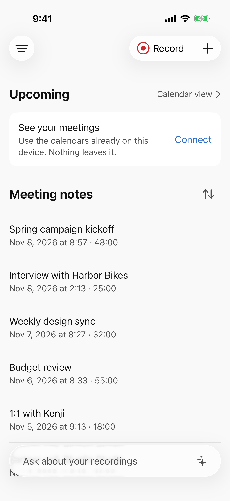
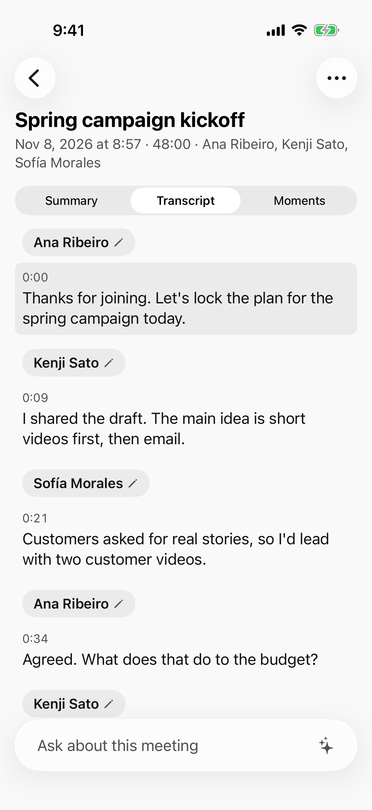
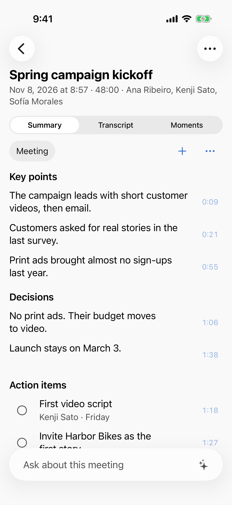
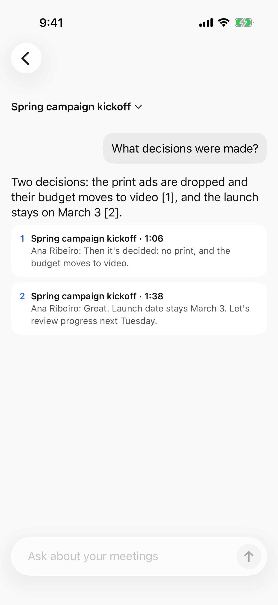
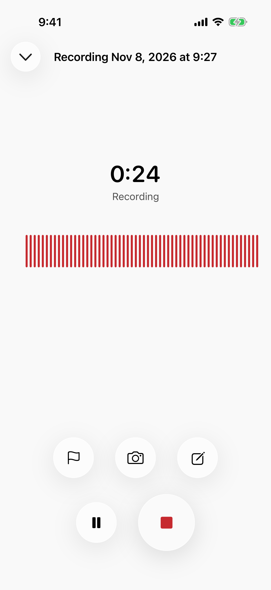
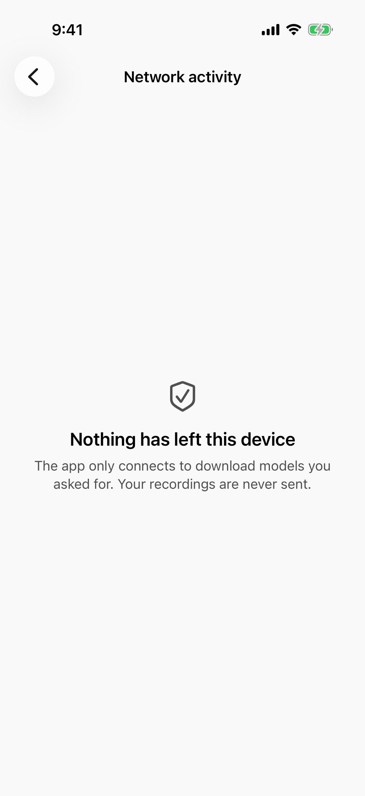

<p align="center"></p>

<h1 align="center">Meetlaud</h1>

<p align="center"><strong>Your meetings, remembered. On your iPhone, not in someone else's cloud.</strong></p>

<p align="center">
English · <a href="README.ja.md">日本語</a> · <a href="README.pt-BR.md">Português</a> · <a href="README.es.md">Español</a>
</p>

<p align="center">


</p>

Meetlaud records your meetings, transcribes them, tells you who said what, writes the summary, and answers your questions about them. All of it runs on your iPhone or iPad.

- **Nothing to buy.** No recorder, no clip-on device. The phone in your pocket already has a great microphone and a chip built for AI.
- **Nothing to pay every month.** No subscription and no limit on minutes. Record a 3-hour workshop as often as you like.
- **Nowhere for your data to go.** No account and no server. Your recordings never leave the device unless you send them yourself.
- **Nothing to take on faith.** The code is open. Anyone can read it and check every promise on this page.

<p align="center">
<picture><source media="(prefers-color-scheme: dark)" srcset="docs/screenshots/01-home-dark.png"></picture>
<picture><source media="(prefers-color-scheme: dark)" srcset="docs/screenshots/02-transcript-dark.png"></picture>
<picture><source media="(prefers-color-scheme: dark)" srcset="docs/screenshots/03-summary-dark.png"></picture>
<picture><source media="(prefers-color-scheme: dark)" srcset="docs/screenshots/04-ask-dark.png"></picture>
</p>

<p align="center"><sub>Screenshots use fictional meetings and people.</sub></p>

> **Status: pre-release.** Every feature below is built and tested, and the core flows (record, transcribe, speakers, summaries) have run on a real iPhone 17. It is not on the App Store yet. You can build it today ([how](#build-it-yourself)), and a public TestFlight comes next.

## Why Meetlaud

Most AI note-takers ask you to buy a device, pay a monthly plan, and send your audio to servers you will never see. For a sales call, a board meeting, a patient visit, or a job interview, that is a lot to accept.

Phones are now fast enough to do this work themselves. Meetlaud uses open AI models that run directly on the iPhone's Neural Engine and GPU. Once a model is downloaded, it works in airplane mode.

| | Meetlaud |
|---|---|
| Hardware | The iPhone or iPad you already own |
| Price | Free and open source |
| Recording limit | None |
| Where the AI runs | On your device |
| Account | None. There is nothing to sign up for |
| Works offline | Yes, after the models are downloaded |
| Source code | Open, Apache-2.0 |

## What it does

**Record**
- One tap to record, from the app, a widget, the Lock Screen, Control Center, the Action Button, or Shortcuts.
- Keeps recording with the screen locked or the app in the background, with a Live Activity.
- Survives crashes and interruptions: a recording cut short by a call or a crash is recovered.
- Mark moments, add notes, and take photos while you record.
- Import audio files you already have.

**Understand**
- **Transcription** with Whisper or Apple Speech, tested in English, Japanese, Portuguese, and Spanish. Tap any line to hear it.
- **Speaker detection**: the transcript shows who spoke when. Name a voice once, and Meetlaud can suggest that person in the next meeting. Voice prints are optional and stay on the device.
- **Summaries** from templates (meeting, interview, lecture, call, and more), or one you write. Every key point, decision, and action item links to the moment it was said, so you can check it.
- **Ask**: question one meeting, a folder, or your whole library. Answers cite their sources.
- Action items go to Reminders. Mind maps, custom vocabulary for names and jargon, and a clean reading mode without "um" and "uh".

**Stay in control**
- Folders, search across every transcript, a calendar view of meetings and recordings.
- App lock with Face ID, and password-protected export of your whole library.
- **AI models screen:** choose the model for each job, see what fits your device, and run a speed test on your own audio.
- **Network activity screen:** lists every connection the app has ever made. On a fresh install it says "Nothing has left this device".
- Interface in English, Japanese, Portuguese, and Spanish, with VoiceOver and Dynamic Type.

<p align="center">
<picture><source media="(prefers-color-scheme: dark)" srcset="docs/screenshots/05-recording-dark.png"></picture>
<picture><source media="(prefers-color-scheme: dark)" srcset="docs/screenshots/06-network-dark.png"></picture>
</p>

## Privacy you can check

Meetlaud makes exactly two kinds of connection, and both are listed in **Settings > Network activity**:

1. **AI model downloads that you start.** They come from Hugging Face, at pinned versions with checked hashes. No meeting content is sent.
2. **Optional: your own computer.** If you pair a desktop app on your own network, new meetings go straight to it, encrypted. Today this works with [Get Things Done](https://github.com/geovanneb/get-things-done), an open-source work memory for AI tools that runs on your computer. Nothing passes through the internet.

There is no analytics, no crash-reporting service, no advertising, and no account. The build enforces this: `make check` fails if any code outside the download module and the connector to your computer opens a network connection. Details in [Privacy](docs/PRIVACY.md).

## Requirements

| | Records and transcribes | Summaries and Ask |
|---|---|---|
| iPhone or iPad on iOS / iPadOS 26 | Yes | Needs about 8 GB of memory (for example iPhone 15 Pro or later, or an iPad with an M chip) |

Models are downloaded once, over Wi-Fi by default: about 0.2 to 0.7 GB for transcription and 1.6 GB for summaries. Apple Speech needs no download.

## Build it yourself

You need a Mac with Xcode 26 and [Homebrew](https://brew.sh).

```sh
git clone <this repository>
cd meetlaud
make bootstrap        # installs the tools and generates the Xcode project
open Meetlaud.xcodeproj
```

Run the `Meetlaud` scheme on a simulator. To run on your own iPhone, add your team ID to `Config/Local.xcconfig` (see [CONTRIBUTING.md](CONTRIBUTING.md)).

## How it works

Swift 6 and SwiftUI, in local Swift packages with strict boundaries: the domain layer is pure Swift, every AI engine sits behind a port, and only one large model is in memory at a time.

| Job | Engine | Model license |
|---|---|---|
| Transcription | [WhisperKit](https://github.com/argmaxinc/argmax-oss-swift) (Core ML), Apple Speech | MIT (Whisper) |
| Speaker detection and voice prints | [FluidAudio](https://github.com/FluidInference/FluidAudio) (pyannote Community-1, Core ML) | CC-BY-4.0 |
| Summaries and Ask | [MLX Swift](https://github.com/ml-explore/mlx-swift) with Qwen 3.5 2B | Apache-2.0 |
| Search | Apple on-device embeddings, SQLite FTS5 via [GRDB](https://github.com/groue/GRDB.swift) | |

Read more: [Architecture](docs/architecture.md) · [On-device AI](docs/on-device-ai.md) · [Model management](docs/model-management.md) · [Connectors](docs/connectors.md) · [All docs](docs/README.md)

## Contributing

Contributions are welcome, from a typo to a new language model. Start with [CONTRIBUTING.md](CONTRIBUTING.md). Good places to begin:

- **Translations:** native review of Japanese, Portuguese, and Spanish.
- **Testing on real devices:** older iPhones, iPads, long meetings, noisy rooms.
- **Summary templates** for your profession.
- **Android:** a native Android app is planned. See [Bringing Meetlaud to Android](docs/porting-android.md).

See the [roadmap](ROADMAP.md) for what comes next. Found a privacy or security issue? Please follow [SECURITY.md](SECURITY.md) instead of opening a public issue.

## Good to know

- **AI can be wrong.** Summaries and answers link to their sources so you can check them. Do not rely on them for medical, legal, or financial decisions without checking.
- **Ask before you record.** Laws on recording conversations differ by country and state, and some require everyone's consent. That is your responsibility, and the app reminds you before your first recording.
- **Phone calls:** iOS does not let apps record calls. You can import recordings made by iOS itself.

## License and trademarks

The code is licensed under [Apache-2.0](LICENSE). Models and libraries keep their own licenses, listed in [THIRD_PARTY_NOTICES.md](THIRD_PARTY_NOTICES.md).

The Apache license covers the code, not the Meetlaud name or logo. You are welcome to fork the project. Please give your version a different name and icon so people can tell them apart.

Meetlaud is an independent project. It is not affiliated with, endorsed by, or sponsored by any maker of recording devices or note-taking services. iPhone, iPad, and Apple are trademarks of Apple Inc. All other trademarks belong to their owners.
