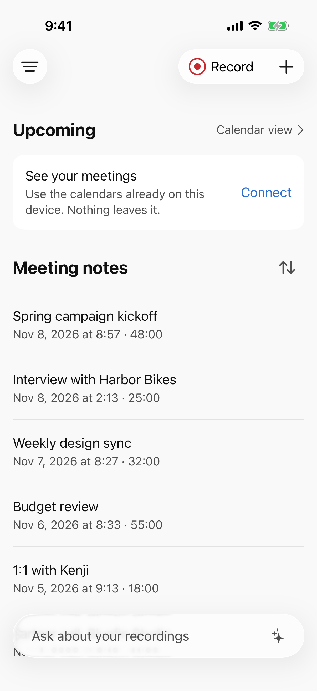
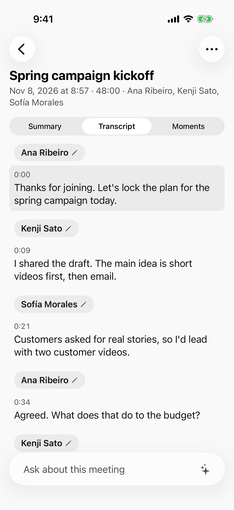
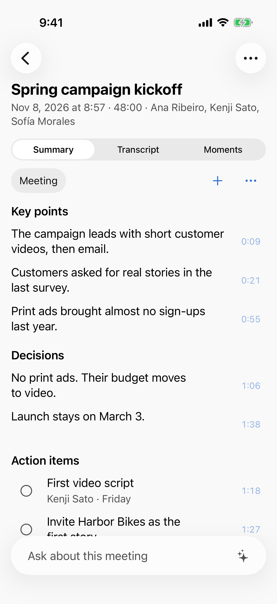
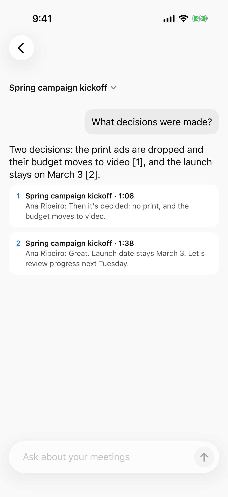
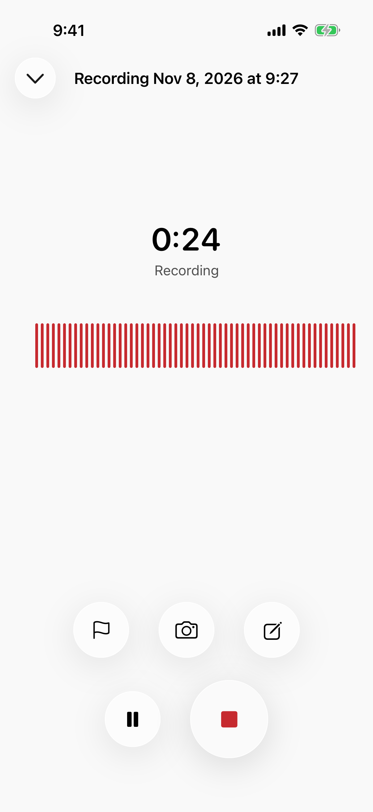
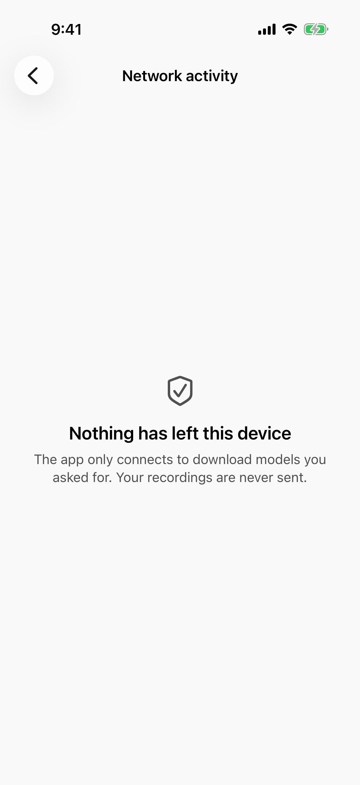

<p align="center"></p>

<h1 align="center">Meetlaud</h1>

<p align="center"><strong>Suas reuniões, lembradas. No seu iPhone, não na nuvem de outra pessoa.</strong></p>

<p align="center">
<a href="README.md">English</a> · <a href="README.ja.md">日本語</a> · Português · <a href="README.es.md">Español</a>
</p>

<p align="center">


</p>

O Meetlaud grava suas reuniões, transcreve, mostra quem disse o quê, escreve o resumo e responde às suas perguntas sobre elas. Tudo roda no seu iPhone ou iPad.

- **Nada para comprar.** Sem gravador, sem aparelho preso na roupa. O celular no seu bolso já tem um ótimo microfone e um chip feito para IA.
- **Nada para pagar todo mês.** Sem assinatura e sem limite de minutos. Grave um workshop de 3 horas quantas vezes quiser.
- **Nenhum lugar para onde seus dados possam ir.** Sem conta e sem servidor. Suas gravações nunca saem do aparelho, a não ser que você mesmo as envie.
- **Nada para aceitar na base da confiança.** O código é aberto. Qualquer pessoa pode ler e conferir cada promessa desta página.

<p align="center">
<picture><source media="(prefers-color-scheme: dark)" srcset="docs/screenshots/01-home-dark.png"></picture>
<picture><source media="(prefers-color-scheme: dark)" srcset="docs/screenshots/02-transcript-dark.png"></picture>
<picture><source media="(prefers-color-scheme: dark)" srcset="docs/screenshots/03-summary-dark.png"></picture>
<picture><source media="(prefers-color-scheme: dark)" srcset="docs/screenshots/04-ask-dark.png"></picture>
</p>

<p align="center"><sub>As imagens usam reuniões e pessoas fictícias. O app está em inglês nas imagens e também fala português.</sub></p>

> **Status: pré-lançamento.** Todos os recursos abaixo estão prontos e testados, e os fluxos principais (gravar, transcrever, identificar pessoas, resumir) já rodaram em um iPhone 17 real. Ainda não está na App Store. Você pode compilar hoje (veja "Compile você mesmo"), e um TestFlight público vem a seguir.

## Por que o Meetlaud

A maioria dos assistentes de reunião com IA pede que você compre um aparelho, pague um plano mensal e envie seu áudio para servidores que você nunca vai ver. Numa ligação de vendas, numa reunião de diretoria, numa consulta ou numa entrevista de emprego, isso é pedir muito.

Os celulares já são rápidos o bastante para fazer esse trabalho sozinhos. O Meetlaud usa modelos de IA abertos que rodam direto no Neural Engine e na GPU do iPhone. Depois de baixar um modelo, tudo funciona em modo avião.

| | Meetlaud |
|---|---|
| Hardware | O iPhone ou iPad que você já tem |
| Preço | Gratuito e de código aberto |
| Limite de gravação | Nenhum |
| Onde a IA roda | No seu aparelho |
| Conta | Nenhuma. Não há cadastro |
| Funciona offline | Sim, depois de baixar os modelos |
| Código-fonte | Aberto, Apache-2.0 |

## O que ele faz

**Gravar**
- Um toque para gravar: no app, num widget, na Tela Bloqueada, na Central de Controle, no Botão de Ação ou pelo app Atalhos.
- Continua gravando com a tela bloqueada ou o app em segundo plano, com Atividade ao Vivo.
- Resiste a falhas e interrupções: uma gravação cortada por uma ligação ou por um travamento é recuperada.
- Marque momentos, faça anotações e tire fotos enquanto grava.
- Importe arquivos de áudio que você já tem.

**Entender**
- **Transcrição** com Whisper ou Apple Speech, testada em inglês, japonês, português e espanhol. Toque em qualquer frase para ouvi-la.
- **Identificação de quem fala:** a transcrição mostra quem falou e quando. Dê nome a uma voz uma vez, e o Meetlaud pode sugerir essa pessoa na próxima reunião. As impressões de voz são opcionais e ficam no aparelho.
- **Resumos** a partir de modelos (reunião, entrevista, aula, ligação e outros) ou de um modelo seu. Cada ponto principal, decisão e tarefa leva ao momento em que foi dito, para você conferir.
- **Pergunte:** pergunte sobre uma reunião, uma pasta ou toda a sua biblioteca. As respostas citam as fontes.
- Tarefas vão para o app Lembretes. Mapas mentais, vocabulário próprio para nomes e jargões, e um modo de leitura limpo, sem "é…" e "hum".

**Manter o controle**
- Pastas, busca em todas as transcrições e um calendário com reuniões e gravações.
- Bloqueio com Face ID e exportação de toda a biblioteca protegida por senha.
- **Tela de modelos de IA:** escolha o modelo de cada tarefa, veja o que cabe no seu aparelho e faça um teste de velocidade com o seu próprio áudio.
- **Tela de atividade de rede:** lista toda conexão que o app faz, para baixar modelos ou para o computador que você pareou. Numa instalação nova, ela diz "Nada saiu deste aparelho". Você pode limpar o histórico.
- Interface em inglês, japonês, português e espanhol, com VoiceOver e Tipo Dinâmico.

<p align="center">
<picture><source media="(prefers-color-scheme: dark)" srcset="docs/screenshots/05-recording-dark.png"></picture>
<picture><source media="(prefers-color-scheme: dark)" srcset="docs/screenshots/06-network-dark.png"></picture>
</p>

## Privacidade que você pode conferir

O Meetlaud faz exatamente dois tipos de conexão, e os dois aparecem em **Ajustes > Atividade de rede**:

1. **Downloads de modelos de IA que você inicia.** Vêm do Hugging Face, em versões fixas e com hash verificado. Nenhum conteúdo de reunião é enviado.
2. **Opcional: o seu próprio computador.** Se você parear um app de desktop na sua própria rede, as novas reuniões vão direto para ele, criptografadas. Hoje isso funciona com o [Get Things Done](https://github.com/geovanneb/get-things-done), uma memória de trabalho de código aberto para ferramentas de IA, que roda no seu computador. Nada passa pela internet.

Não há analytics, serviço de relatório de falhas, publicidade nem conta. A compilação garante isso: `make check` falha se qualquer código fora do módulo de download e do conector com o seu computador abrir uma conexão de rede. Detalhes em [Privacidade](docs/PRIVACY.pt-BR.md).

## Requisitos

| | Grava e transcreve | Resumos e perguntas |
|---|---|---|
| iPhone ou iPad com iOS / iPadOS 26 | Sim | Precisa de cerca de 8 GB de memória (por exemplo, iPhone 15 Pro ou mais novo, ou iPad com chip M) |

Os modelos são baixados uma vez, por Wi-Fi por padrão: cerca de 0,2 a 0,7 GB para transcrição e 1,6 GB para resumos. O Apple Speech não precisa de download.

## Compile você mesmo

Você precisa de um Mac com Xcode 26 e [Homebrew](https://brew.sh).

```sh
git clone <este repositório>
cd meetlaud
make bootstrap        # instala as ferramentas e gera o projeto do Xcode
open Meetlaud.xcodeproj
```

Rode o esquema `Meetlaud` num simulador. Para rodar no seu iPhone, coloque o ID do seu time em `Config/Local.xcconfig` (veja [CONTRIBUTING.md](CONTRIBUTING.md), em inglês).

## Como funciona

Swift 6 e SwiftUI, em pacotes Swift locais com fronteiras rígidas: a camada de domínio é Swift puro, cada motor de IA fica atrás de uma porta, e só um modelo grande fica na memória por vez.

| Tarefa | Motor | Licença do modelo |
|---|---|---|
| Transcrição | [WhisperKit](https://github.com/argmaxinc/argmax-oss-swift) (Core ML), Apple Speech | MIT (Whisper) |
| Quem fala e impressões de voz | [FluidAudio](https://github.com/FluidInference/FluidAudio) (pyannote Community-1, Core ML) | CC-BY-4.0 |
| Resumos e perguntas | [MLX Swift](https://github.com/ml-explore/mlx-swift) com Qwen 3.5 2B | Apache-2.0 |
| Busca | Embeddings da Apple no aparelho, SQLite FTS5 via [GRDB](https://github.com/groue/GRDB.swift) | |

A documentação técnica está em inglês: [Arquitetura](docs/architecture.md) · [IA no aparelho](docs/on-device-ai.md) · [Modelos](docs/model-management.md) · [Conectores](docs/connectors.md) · [Toda a documentação](docs/README.md)

## Como contribuir

Contribuições são bem-vindas, de um erro de digitação a um novo modelo de linguagem. Comece pelo [CONTRIBUTING.md](CONTRIBUTING.md). Issues podem ser abertas em português. Bons pontos de partida:

- **Traduções:** revisão nativa de japonês, português e espanhol.
- **Testes em aparelhos reais:** iPhones mais antigos, iPads, reuniões longas, salas barulhentas.
- **Modelos de resumo** para a sua profissão.
- **Android:** um app nativo para Android está planejado. Veja [Bringing Meetlaud to Android](docs/porting-android.md).

Veja o [roadmap](ROADMAP.md) para os próximos passos. Encontrou um problema de privacidade ou segurança? Siga o [SECURITY.md](SECURITY.md) em vez de abrir uma issue pública.

## Bom saber

- **A IA pode errar.** Resumos e respostas levam às fontes para você conferir. Não use sem conferir para decisões médicas, jurídicas ou financeiras.
- **Peça autorização antes de gravar.** As leis sobre gravar conversas mudam de país para país, e algumas exigem o consentimento de todos. Isso é responsabilidade sua, e o app lembra você antes da primeira gravação.
- **Ligações telefônicas:** o iOS não permite que apps gravem ligações. Você pode importar gravações feitas pelo próprio iOS.

## Licença e marcas

O código usa a licença [Apache-2.0](LICENSE). Modelos e bibliotecas mantêm as próprias licenças, listadas em [THIRD_PARTY_NOTICES.md](THIRD_PARTY_NOTICES.md).

A licença Apache cobre o código, não o nome nem o logo do Meetlaud. Você pode fazer um fork à vontade. Só dê à sua versão outro nome e outro ícone, para que as pessoas saibam diferenciar.

O Meetlaud é um projeto independente. Não tem vínculo com nenhum fabricante de gravadores ou serviço de anotações, nem é endossado ou patrocinado por eles. iPhone, iPad e Apple são marcas da Apple Inc. As demais marcas pertencem aos seus donos.
